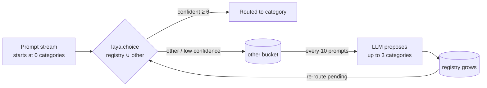

# Laya Self-Evolving Router

[](https://github.com/MiguelCarrascoB/laya-self-evolving-router/actions/workflows/ci.yml)
[](pyproject.toml)
[](LICENSE)
[](#quickstart)

A prompt-intent router that starts with no categories and grows its own taxonomy as traffic arrives: Laya routes on-device, an LLM names new categories only when prompts don't fit.

> **At a glance** (650 prompts, Apple M4 Pro)
>
> | | |
> |---|---|
> | Routing latency | **27–32 ms** median per decision, no tokens generated |
> | LLM calls | **39** over 650 prompts in the best run (one per 10 `other` prompts) |
> | Registry | **0 → 30** categories from a cold start (30 is the cap) |
> | Coverage ceiling | ~**65%** routed out of `other`; the rest is Laya saying no single category fits |
> | Best config ([39-run ablation](docs/ablations.md)) | **seeded + hardened** proposer: 0.467 semantic accuracy, 0 duplicate pairs |


One cold-start run, first pass only. By prompt 100 the registry holds 21 of its eventual 30 and the
`other`-rate has fallen from 100% to 38% across the rest of the stream. The band stays wide (20-52%)
because it is a 50-prompt rolling window over a shuffled stream. Regenerate with
`python scripts/plot_growth.py`.

## How it works

Classification runs through [Laya](https://github.com/NandhaKishorM/laya), via [`laya-mlx`](https://github.com/mizorewww/laya-mlx) on Apple Silicon or [`laya-coreml`](https://github.com/mizorewww/laya-coreml). Each call picks one option from a list rebuilt on the fly: the categories that exist right now, plus `other`.



- **Options**: one name plus a one-line description per category, capped at 30 (see [Limits](#limits)). Empty at start unless `--seed-file` provides categories.
- **Confidence gate**: a non-`other` pick that fails the gate counts as `other`. `bucket-topprob` (default) needs calibrated probability ≥ 0.5 at ≤10 options and ≥ 0.9 at 11+; `frozen` keeps the original `--threshold` entropy check.
- **Proposer**: sees 10 `other` prompts at a time and returns a JSON array of up to 3 categories, or `[]`. OpenAI-compatible endpoint, with LMStudio as fallback.
- **Log**: every decision, probability, latency, category birth and re-route goes to `results/*.json`, which the visualizer reads.

```
src/laya_evolve/
  router.py        SelfEvolvingRouter: Laya + registry + per-step event log
  categories.py    CategoryRegistry: monotonic growth, near-duplicate rejection
  llm.py           LLMCategoryProposer: OpenAI-compatible client + LMStudio fallback
  metrics.py       confidence-gate policies and run metrics
  simulation.py    closed loop: route → batch "other" → propose → re-route
  cli.py           `laya-evolve simulate` / `laya-evolve live`
data/dataset.jsonl 650 synthetic prompts: 10 seeded intents × 55, plus 10 novel intents × 10
visualizer/        single-file offline dashboard
scripts/           growth plot, routing probe, ablation runner/analysis, registry judge
```

## Quickstart

Requires [`uv`](https://docs.astral.sh/uv/). Only category discovery touches the network, so you need an LLM endpoint in `.env` (gitignored, read only at runtime via `python-dotenv`).

```bash
uv sync
cp .env.example .env          # set OPENAI_API_KEY (optionally OPENAI_BASE_URL / OPENAI_MODEL)
uv run laya-evolve simulate   # data/dataset.jsonl → results/results.json
uv run laya-evolve live       # type prompts, watch categories appear
```

| Flag | Values (default **bold**) | Commands |
|---|---|---|
| `--seed-file FILE` | none, `data/seeds_canonical.json`, `data/seeds_imperfect.json` | both |
| `--proposer` | `blind`, **`as-today`**, `hardened`, `system-placement` | both |
| `--few-shot` | `none`, `three`, `full` (default: `LAYASYS_FEWSHOT` env, then `full`) | both |
| `--gate` | **`bucket-topprob`**, `frozen` | both |
| `--dedup` | **`none`**, `token-jaccard-025` | both |
| `--threshold` | float, **`0.5`** | both |
| `--backend` / `--model` | **`mlx`** / `coreml`; checkpoint defaults to `aac6fef/laya-mlx` / `aac6fef/laya-coreml` | both |
| `--seed N` | stream permutation for paired runs; default file order | `simulate` |
| `--dataset` / `--out` | **`data/dataset.jsonl`** / **`results/results.json`** | `simulate` |

Core ML backend (`laya-coreml` requires Python < 3.14):

```bash
uv sync --extra coreml
uv run laya-evolve simulate --backend coreml --out results/results-coreml.json
```

### Visualizer

```bash
python -m http.server 8787    # from the repo root
# open http://localhost:8787/visualizer/visualizer.html
```

It replays a run step by step (category births, rolling accuracy and `other`-rate, where each prompt
ended up) from `results/results.json`, `results/results-coreml.json`, or any results file you drop on it.


## Results

650 prompts, Apple M4 Pro, threshold `0.5`, cold start; every run fills the registry to its 30-category cap.

| Metric | Few-shot proposer, MLX<br/>`results-v3-full.json` | Base proposer, MLX<br/>`aac6fef/laya-mlx` FP16 | Base proposer, Core ML<br/>`aac6fef/laya-coreml` |
|---|---:|---:|---:|
| Coverage (routed out of `other`) | 65.4% | 67.4% | 63.2% |
| Label-match rate (of covered) | 62.1% | 32.4% | 12.7% |
| Accuracy (exact label) | 40.6% | 21.9% | 8.0% |
| Seed categories recovered | 10 / 10 | 5 / 10 | 2 / 10 |
| Re-routed prompts | 486 | 467 | 521 |
| Latency p50 / p95 | 32.0 / 37.6 ms | 27.4 / 32.7 ms | 28.3 / 365 ms¹ |
| LLM calls / wall time | 39 / 133 s | 15 / 145 s | 15 / 156 s |

¹ Core ML's p95 comes from pipeline initialization on the first long input.

What this shows:

- **The cold start works.** Laya is routing against a grown registry within the first ~15% of the stream, and re-routing gives held prompts a second pass (486 in the few-shot run).
- **Taxonomy quality is the bottleneck, not Laya.** The base proposer coins valid intents under different names; giving it the canonical names and descriptions lifts seed recovery from 5 to 10 of 10 and label-match from 32.4% to 62.1%.
- **Coverage stops near 65%** because residual `other` events are almost all Laya deciding no single category fits (100% and 99% across two reproduction runs). Moving past that needs routing-policy changes (bucketing, hierarchy, multi-label), not a better proposer.

### Ablation campaign

39 runs over proposer mode, seeding, gate and dedup, scored with semantic (LLM-judged) metrics and a
measured noise floor. Full table and method: **[docs/ablations.md](docs/ablations.md)**; manual audit of
proposer duplication: [docs/replay_audit.md](docs/replay_audit.md).

| Verdict | Evidence |
|---|---|
| Seeding the registry is a real win | +5.8 to +8.2 pts coverage, +13 to +20 pts novel-intent absorption |
| Showing the registry to the proposer kills duplicates | blind: 6.3 dup pairs per registry; any registry-aware mode: 0–0.7 |
| Best config: seeded + hardened | 0.467 semantic accuracy, 0.578 coverage, 0 dup pairs |
| `--few-shot full` substitutes for seeds | +15 pts semantic accuracy cold (0.521), nothing when seeded (0.466 vs 0.467) |
| Bucket gate vs frozen gate | within noise; kept as default for stationarity |
| `token-jaccard-025` dedup | neutral; not shipped as default |

## Limits

- **One label per prompt.** A prompt spanning two intents loses one, which is most of the residual `other`-rate.
- **30-category cap.** Laya's question head is 192 tokens (not the 512 total): one-line descriptions fit ~7–9 options before truncation, and at 30 options each category gets ~4–5 tokens. The routing probe (`scripts/probe_routing.py`) found name-only criteria beating full descriptions by 2–3× at every registry size.
- **Grow-only registry.** No merging, no retirement, no persistence across runs.
- **`live` mode** calls the proposer after every `other` prompt instead of every 10.
- **Synthetic data.** 650 English prompts with co-written labels; accuracy on real traffic is unmeasured.
- **Stochastic proposer.** The provider rejects `temperature=0`; variance is covered only by the ablation noise floor.

## Roadmap

- [ ] Name-only / compact criteria format for the Laya option list
- [ ] Proposal dedup by semantic similarity, not substring heuristics
- [ ] Threshold and batch-size sweeps with a calibration harness
- [ ] Registry persistence across runs (resume, merge, prune)
- [ ] Streaming re-route: re-classify as soon as a category is born
- [ ] More Laya backends (ONNX, Metal)

## Related

- **[laya-router](https://github.com/MiguelCarrascoB/laya-router)**: the serving-side sibling. A FastAPI service that uses Laya to classify prompt *complexity* and route to a fixed model table (with a confidence-gated escalation and an injection guardrail). This repo asks the opposite question: what if the label set itself is not fixed?

## License

Apache-2.0, like `laya-mlx` and `laya-coreml`. See [LICENSE](LICENSE) and [NOTICE.md](NOTICE.md) for upstream attribution.

<details>
<summary><b>🇪🇸 Español</b></summary>

**Un router de intenciones que empieza sin categorías y construye su propia taxonomía a medida que llega tráfico.** Laya clasifica en el dispositivo (MLX o Core ML, ~30 ms por decisión, sin generar tokens); un LLM solo interviene para proponer categorías nuevas cuando los prompts no encajan en ninguna.

**Cómo funciona**
- Cada prompt se clasifica contra las categorías existentes más `other`. Una puerta de confianza manda a `other` las elecciones dudosas.
- Cada 10 prompts en `other`, un LLM (endpoint compatible con OpenAI, con LMStudio de respaldo) propone hasta 3 categorías nuevas; el registro crece y los prompts pendientes se re-enrutan.
- Todo (decisiones, probabilidades, latencias, nacimientos de categorías) se registra en `results/*.json` y se reproduce en un visualizador offline.

**Resultados (650 prompts sintéticos, Apple M4 Pro)**
- De 0 a 30 categorías desde arranque en frío; ~65 % de cobertura fuera de `other`.
- 39 llamadas al LLM en la mejor ejecución (una por cada 10 prompts `other`).
- Campaña de ablación de 39 ejecuciones con métricas semánticas evaluadas por LLM y suelo de ruido medido: la mejor configuración es *registro sembrado + proposer endurecido* (0,467 de precisión semántica, 0 pares duplicados).

**Límites:** una etiqueta por prompt, tope de 30 categorías (la cabeza de pregunta de Laya es de 192 tokens), registro que solo crece, datos sintéticos (sin medir en tráfico real).

**Inicio rápido**
```bash
uv sync
cp .env.example .env          # OPENAI_API_KEY (opcional OPENAI_BASE_URL / OPENAI_MODEL)
uv run laya-evolve simulate
uv run laya-evolve live
```

Proyecto hermano: [laya-router](https://github.com/MiguelCarrascoB/laya-router) (servicio FastAPI que enruta por complejidad con Laya).

</details>
