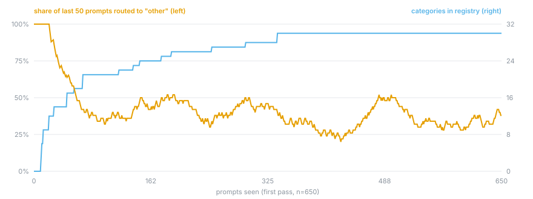
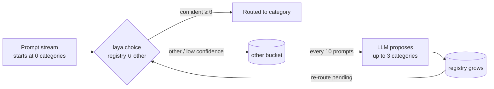
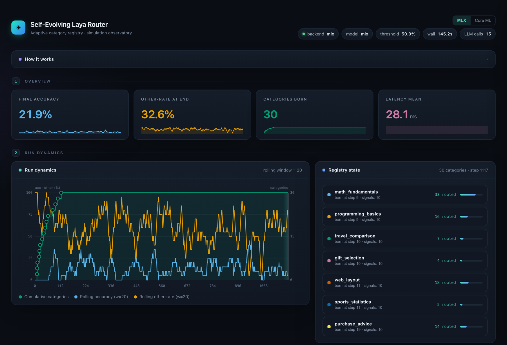

# Laya Self-Evolving Router

[](https://github.com/MiguelCarrascoB/laya-self-evolving-router/actions/workflows/ci.yml)
[](pyproject.toml)
[](LICENSE)

A prompt-intent router that starts with no categories and grows its own taxonomy as traffic arrives. Each prompt is classified on-device by Laya against the current registry plus an `other` fallback. Prompts that land in `other`, or below the confidence threshold, are held; an LLM proposes new categories from that batch, and Laya re-routes the held prompts against the larger registry.

Routing is local and generates no tokens: a single Laya `choice` call, 27–32 ms median on an M4 Pro. Category discovery is the only step that needs an LLM endpoint, and it runs once per 10 accumulated `other` prompts (39 calls over 650 prompts in the best run).



One run, cold start, first pass only. Everything lands in `other` until categories exist. By prompt
100 the registry holds 21 of its eventual 30 and the `other`-rate has fallen from 100% to 38% across
the rest of the stream, which is the coverage ceiling discussed under [Results](#results). The band
stays wide (20-52%) because it is a 50-prompt rolling window over a shuffled stream. Regenerate with
`python scripts/plot_growth.py`.

---

## How it works

Classification runs through [Laya](https://github.com/NandhaKishorM/laya), via [`laya-mlx`](https://github.com/mizorewww/laya-mlx) on Apple Silicon or [`laya-coreml`](https://github.com/mizorewww/laya-coreml). Laya picks one option from a list assembled fresh on every call: the categories that exist right now, plus `other`.



- Options are rebuilt per call from the registry, one name and a one-line description each, capped at 30 because Laya's question head is 192 tokens (see [Limits](#limits)). The registry starts empty unless `--seed-file` provides initial categories.
- A top non-`other` pick failing the confidence gate is treated as `other`. `--gate bucket-topprob` (default) demotes picks whose calibrated probability is under `0.5` at ≤10 options and under `0.9` at 11+; `--gate frozen` keeps the original `--threshold` (default `0.5`) entropy-confidence check for reproducing earlier runs.
- The proposer sees one batch of 10 `other` prompts at a time and must answer with a JSON array of up to 3 categories, or `[]`. It calls an OpenAI-compatible endpoint and falls back to LMStudio.
- Every decision, probability, latency, category birth and re-route is written to `results/*.json`, which is what the visualizer reads.

## Architecture

```
src/laya_router/
  router.py        SelfEvolvingRouter — Laya + registry + per-step event log
  categories.py    CategoryRegistry — monotonic growth, near-duplicate rejection
  llm.py           LLMCategoryProposer — OpenAI-compatible client + LMStudio fallback
  simulation.py    closed-loop run: route → batch "other" → propose → re-route
  cli.py           `laya-router simulate` / `laya-router live`
data/dataset.jsonl 650 synthetic prompts: 10 seeded intents × 55, plus 10 novel intents × 10
visualizer/visualizer.html   single-file offline dashboard (story mode, charts, tables)
results/           simulation output (JSON) — what the visualizer reads
```

## Run it

Requires [`uv`](https://docs.astral.sh/uv/). Only category discovery reaches the network, so the simulation needs an LLM endpoint configured in `.env`.

```bash
uv sync
cp .env.example .env        # fill OPENAI_API_KEY (gitignored - never commit it)
uv run laya-router simulate  # closed-loop over data/dataset.jsonl → results/results.json
uv run laya-router live      # type prompts, watch categories appear

# experiment controls (both commands)
#   --seed N                 stream permutation for paired comparisons; omit for file order
#   --seed-file FILE         seeded start (data/seeds_canonical.json | data/seeds_imperfect.json)
#   --proposer MODE          blind | as-today | hardened | system-placement
#   --few-shot FS            none | three | full (default: LAYASYS_FEWSHOT env, then full)
#   --gate POLICY            bucket-topprob (default) | frozen
#   --dedup RULE             none (default) | token-jaccard-025

# view the dashboard (serve once from the repo root)
python -m http.server 8787
# open http://localhost:8787/visualizer/visualizer.html
```

The dashboard replays a run step by step: category births, rolling accuracy and `other`-rate, and
where each prompt ended up. It reads `results/results.json` and `results/results-coreml.json`, or any
results file you drop onto it.



Core ML backend (Python ≤ 3.13; `laya-coreml` requires `<3.14`):

```bash
uv sync --extra coreml
uv run laya-router simulate --backend coreml --model aac6fef/laya-coreml --out results/results-coreml.json
```

`.env` is gitignored and is only read at runtime through `python-dotenv`; nothing in the code reads the key from anywhere else.

## Results

650 prompts, Apple M4 Pro, threshold `0.5`. Every run below fills the registry to its 30-category cap from a cold start.

### Few-shot proposer, MLX (`results/results-v3-full.json`)

The proposer's system prompt carries the canonical seed names with their descriptions, allows up to three proposals, and accepts `[]` as an answer. In a four-way ablation this variant bought 19 points of exact-label accuracy and 50 points of seed recovery for 2 points of coverage.

| Metric | Value |
|---|---:|
| Seed categories recovered | 10 / 10 |
| Label-match rate (of covered) | 62.1% |
| Accuracy (exact label) | 40.6% |
| Coverage (routed out of `other`) | 65.4% |
| Other-rate at end | 34.6% |
| Novel prompts absorbed (of 100) | 79 |
| Re-routed prompts | 486 |
| Decision latency p50 / p95 | 32.0 ms / 37.6 ms |
| LLM calls / wall time | 39 / 133 s |

Coverage stops near 65% because essentially all residual `other` events are Laya deciding that no single category fits — 100% and 99% of them across the two reproduction runs, with confidence-gate demotions accounting for 0 and 2. Getting past that ceiling means changing routing policy (bucketing, hierarchy, multi-label) rather than changing the proposer.

### Cross-backend, base proposer

| Metric | MLX `aac6fef/laya-mlx` FP16 | Core ML `aac6fef/laya-coreml` |
|---|---:|---:|
| Coverage (routed out of `other`) | 67.4% | 63.2% |
| Other-rate at end | 32.6% | 36.8% |
| Label-match rate (of covered) | 32.4% | 12.7% |
| Accuracy (exact label) | 21.9% | 8.0% |
| Seed categories recovered | 5 / 10 | 2 / 10 |
| Re-routed prompts | 467 | 521 |
| Decision latency p50 | 27.4 ms | 28.3 ms |
| Decision latency p95 | 32.7 ms | 365 ms (first-call Core ML init) |
| Decision latency mean | 28.1 ms | 50.1 ms |
| Wall time | 145 s | 156 s |
| LLM calls | 15 | 15 |

Categories the MLX run discovered include `math_fundamentals`, `web_layout`, `genealogy_research`, `astronomy_concepts`, `plant_care`, `translation` and `travel_planning`. The Core ML run found `vehicle_maintenance`, `genealogy_research`, `houseplant_care`, `wine_tasting`, `sports_betting` and `food_safety`.

## What the runs show

The cold start works. From zero categories every prompt lands in `other`, and Laya is routing against a grown registry within the first ~15% of the stream.

Taxonomy quality is the limiting factor, not Laya. The base proposer coins valid intents under different names, which is why it recovers only 5 of the 10 seed categories and matches 32% of labels. Hand it the canonical names and full descriptions and it recovers all 10 and matches 62.1%. What the router is worth turns on how the LLM names categories, not on the ~30 ms decision itself.

Core ML keeps up with MLX on coverage (63.2% against 67.4%) but not on label quality: 12.7% label-match against 32.4%, and 2 of 10 seed categories against 5. Its p50 is comparable; its tail is far heavier, 365 ms at p95, from Core ML pipeline initialization on the first long input.

Re-routing is where coverage comes from. 486 held prompts get a second pass once the categories they needed exist.

## Limits

- One label per prompt. A prompt spanning two intents has to lose one of them, which is most of the
  residual `other`-rate.
- The registry stops at 30 categories. The binding constraint is Laya's 192-token question-head budget (not the 512-token total): one-line descriptions fit only ~7–9 options before truncation, and at 30 options each category reaches Laya as ~4–5 tokens. The routing probe (`scripts/probe_routing.py`) measured name-only criteria beating full descriptions by 2–3× at every registry size — the criteria format is the top item of the next campaign.
- The registry only grows. Nothing merges near-duplicates or retires a category that stops earning
  its slot, and nothing persists across runs.
- In `live` mode the proposer runs after every `other` prompt rather than in batches of 10, so it
  makes far more LLM calls per prompt than `simulate` does.
- Results come from 650 synthetic English prompts whose ground-truth labels were written alongside
  them. Accuracy against real traffic is unmeasured.

## Roadmap

- [ ] Semantic (embedding) evaluation instead of exact-label matching
- [ ] Proposal dedup by semantic similarity, not substring heuristics
- [ ] Threshold and batch-size sweeps with a calibration harness
- [ ] Incremental registry persistence across runs (resume, merge, prune)
- [ ] Streaming re-route: re-classify as soon as a category is born, no full drain
- [ ] More Laya backends (ONNX, Metal) and few-shot LLM baselines

## License

Apache-2.0, like `laya-mlx` and `laya-coreml`. See [LICENSE](LICENSE) for the full
text and [NOTICE.md](NOTICE.md) for upstream attribution.
