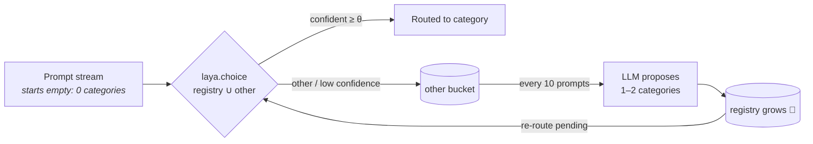

# Laya Self-Evolving Router

<p align="center">
  <svg width="520" height="76" viewBox="0 0 520 76" xmlns="http://www.w3.org/2000/svg" role="img" aria-label="Animated router flow: prompt to laya to category">
    <defs>
      <linearGradient id="lg" x1="0" y1="0" x2="1" y2="0">
        <stop offset="0" stop-color="#0e2233"/>
        <stop offset="0.5" stop-color="#4fd8c3"/>
        <stop offset="1" stop-color="#0e2233"/>
      </linearGradient>
    </defs>
    <line x1="30" y1="38" x2="490" y2="38" stroke="url(#lg)" stroke-width="2"/>
    <circle cx="30" cy="38" r="4.5" fill="#4fd8c3">
      <animateMotion dur="3.2s" repeatCount="indefinite" path="M30,38 L490,38"/>
    </circle>
    <circle cx="70" cy="38" r="11" fill="#0d1219" stroke="#6da2ff" stroke-width="2"/>
    <text x="70" y="42" text-anchor="middle" font-size="11" fill="#6da2ff">p</text>
    <circle cx="260" cy="38" r="16" fill="#0d1219" stroke="#4fd8c3" stroke-width="2">
      <animate attributeName="r" values="14;17;14" dur="3.2s" repeatCount="indefinite"/>
    </circle>
    <text x="260" y="42" text-anchor="middle" font-size="12" fill="#4fd8c3">laya</text>
    <circle cx="450" cy="38" r="11" fill="#0d1219" stroke="#4ade80" stroke-width="2"/>
    <text x="450" y="42" text-anchor="middle" font-size="11" fill="#4ade80">cat</text>
  </svg>
</p>

**A local, zero-generated-token prompt-intent router that starts from an *empty* category registry and grows it while it runs.** Prompts it can't confidently classify fall into `other`, an LLM proposes fresh categories from those, and Laya re-routes the pending traffic against the grown registry — so your router organizes itself instead of being hand-maintained.

<p align="center">
  <b>⚡ ~27 ms decisions</b> &nbsp;·&nbsp; <b>🔋 runs 100% on-device</b> &nbsp;·&nbsp; <b>🌱 zero starting categories</b> &nbsp;·&nbsp; <b>🧠 taxonomy grows itself</b>
</p>

---

## How it works

Every prompt is classified locally by [Laya](https://github.com/NandhaKishorM/laya) (via [`laya-mlx`](https://github.com/mizorewww/laya-mlx) on Apple Silicon or [`laya-coreml`](https://github.com/mizorewww/laya-coreml)) against the *living* registry plus a single `other` fallback. Prompts that fall below a confidence threshold — or land in `other` — are batched, and an LLM proposes new reusable categories that Laya can use on the very next prompt.



Key details:

- **Choice options are built per call** from the living registry — name + one-line description each — capped at 30 (512-token Laya context). Starting set: **zero**.
- **Confidence gate**: the top non-`other` option under `--threshold` (default `0.5`) is also treated as `other`.
- **LLM calls are minimal**: one batched call per 10 accumulated `other` prompts, return-only-JSON constraint, with an OpenAI-compatible primary + LMStudio fallback.
- **Everything is logged**: each routing decision, probability, latency, category birth and re-route lands in `results/*.json`, which powers the offline visualizer.

## Architecture

```
src/laya_router/
  router.py        SelfEvolvingRouter — Laya + registry + per-step event log
  categories.py    CategoryRegistry — monotonic growth, near-duplicate rejection
  llm.py           LLMCategoryProposer — OpenAI-compatible client + LMStudio fallback
  simulation.py    closed-loop run: route → batch "other" → propose → re-route
  cli.py           `laya-router simulate` / `laya-router live`
data/dataset.jsonl 650 synthetic prompts (10 seeded intents × 55, + 100 deliberately novel)
visualizer/visualizer.html   single-file, offline dashboard (story mode, charts, tables)
results/           simulation output (JSON) — what the visualizer reads
```

## Run it

Requires [`uv`](https://docs.astral.sh/uv/). The router (Laya) runs fully local — only category discovery needs an LLM endpoint.

```bash
uv sync
cp .env.example .env        # fill OPENAI_API_KEY (gitignored — never commit it)
uv run laya-router simulate  # closed-loop over data/dataset.jsonl → results/results.json
uv run laya-router live      # type prompts, watch categories appear

# view the dashboard (serve once from the repo root)
python -m http.server 8787
# open http://localhost:8787/visualizer/visualizer.html
```

Core ML backend (Python ≤3.13; `laya-coreml` requires `<3.14`):

```bash
uv sync --extra coreml
uv run laya-router simulate --backend coreml --model aac6fef/laya-coreml --out results/results-coreml.json
```

> **Env safety:** `.env` is gitignored and never read from code — the key is loaded via `python-dotenv` at runtime only. Copy `.env.example`, never commit secrets.

## Results (Apple M4 Pro, 650 prompts)

Every run discovers its own 30-category taxonomy from a cold start, on an Apple M4 Pro.

### Best variant — MLX · few-shot proposer (`results/results-v1-full.json`)

| Metric | Value |
|---|---:|
| Seed categories recovered | **10 / 10** |
| Label-match rate (of covered) | **60.6%** |
| Accuracy (exact label) | 38.8% |
| Coverage (routed out of `other`) | 64.0% |
| Other-rate at end | 36.0% |
| Novel prompts absorbed (of 100) | 82 |
| Re-routed prompts | 516 |
| Decision latency p50 / p95 / mean | 35.3 / 52.4 / 36.4 ms |
| LLM calls / wall time | 68 / 194 s |

### Cross-backend — base proposer

| Metric | MLX · `aac6fef/laya-mlx` FP16 | CoreML · `aac6fef/laya-coreml` |
|---|---:|---:|
| Coverage (routed out of `other`) | **67.4%** | 63.2% |
| Other-rate at end | 32.6% | 36.8% |
| Label-match rate (of covered) | **32.4%** | 12.7% |
| Seed categories recovered | **5 / 10** | 2 / 10 |
| Re-routed prompts | 467 | 521 |
| Decision latency p50 | **27.4 ms** | 28.3 ms |
| Decision latency p95 | **32.7 ms** | 365 ms (first-call Core ML init) |
| Decision latency mean | 28.1 ms | 50.1 ms |
| Wall time | 145 s | 156 s |
| LLM calls | 15 | 15 |

Sample discovered categories — MLX: `math_fundamentals`, `web_layout`, `genealogy_research`, `astronomy_concepts`, `plant_care`, `translation`, `travel_planning`… · CoreML: `vehicle_maintenance`, `genealogy_research`, `houseplant_care`, `wine_tasting`, `sports_betting`, `food_safety`…

## What this taught us

- **Cold start works.** 0 categories → `other` → batched LLM proposals → Laya routes with the grown registry within the first ~15% of the stream.
- **Taxonomy quality is the real lever, not Laya.** The base proposer coins *valid but differently-named* intents, so it only recovers 5/10 seed categories and 32% label-match. Feeding it canonical few-shot names + full descriptions jumps to **10/10 seeds recovered and 60.6% label-match** — the router's value is gated by how well the LLM names categories, not by Laya's ~27 ms decision speed.
- **Core ML ≈ MLX on accuracy**, similar p50, with a heavier tail from Core ML pipeline initialization on first long inputs.
- **Re-routing is where coverage is won**: hundreds of held prompts get a second chance once new categories exist.

## Roadmap

- [ ] Semantic (embedding) evaluation instead of exact-label matching
- [ ] Proposal dedup by semantic similarity, not substring heuristics
- [ ] Threshold / batch-size sweeps with a calibration harness
- [ ] Incremental registry persistence across runs (resume, merge, prune)
- [ ] Streaming re-route (re-classify as soon as a category is born, no full drain)
- [ ] More Laya backends (ONNX, Metal) and few-shot LLM baselines

## License

Apache-2.0, like `laya-mlx` / `laya-coreml`.
